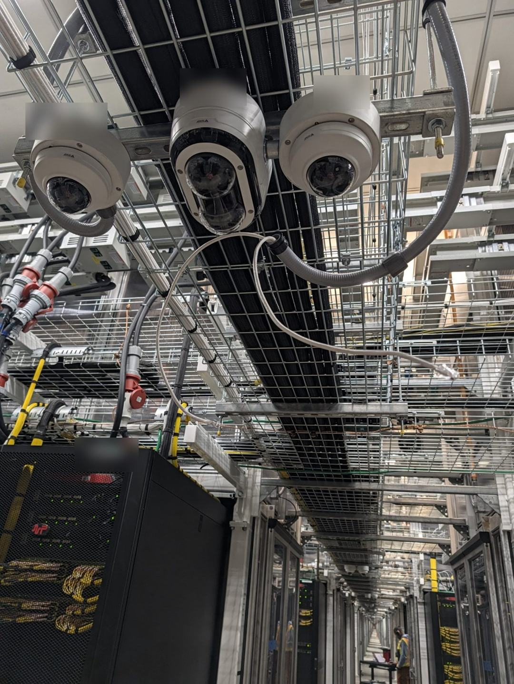
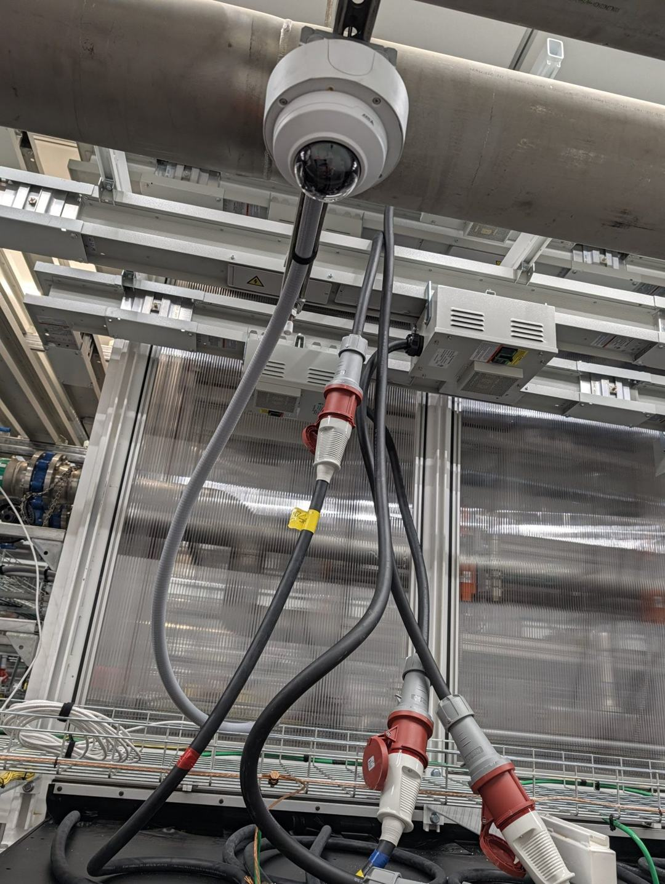
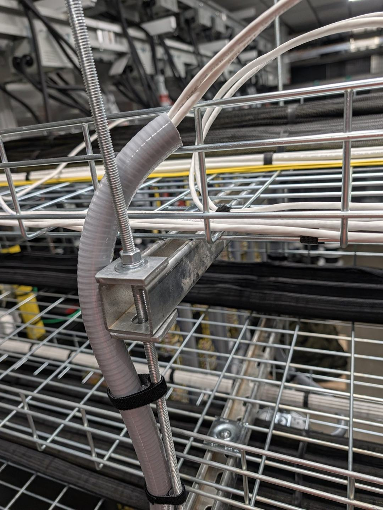
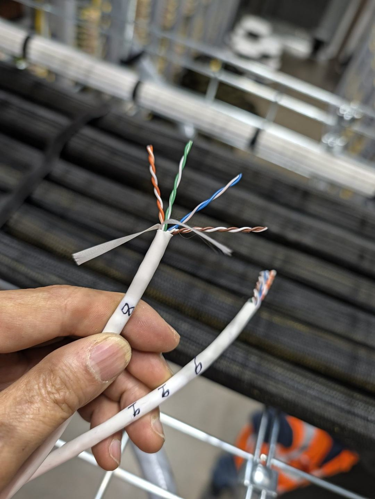
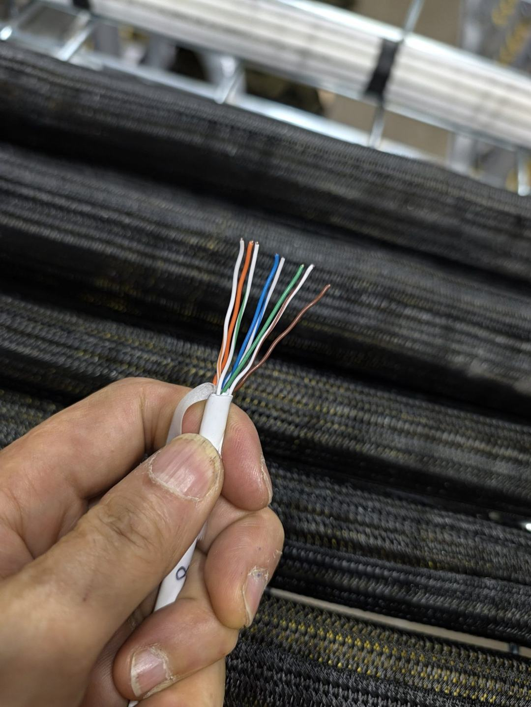
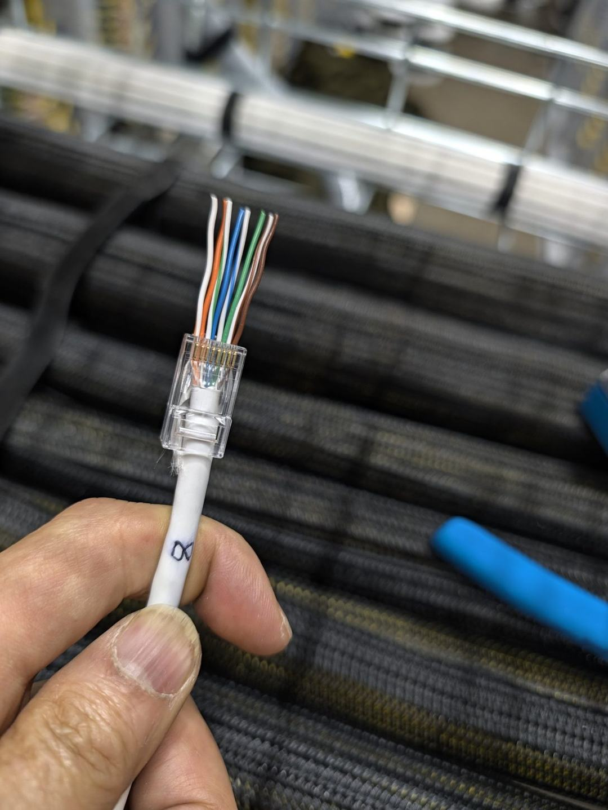
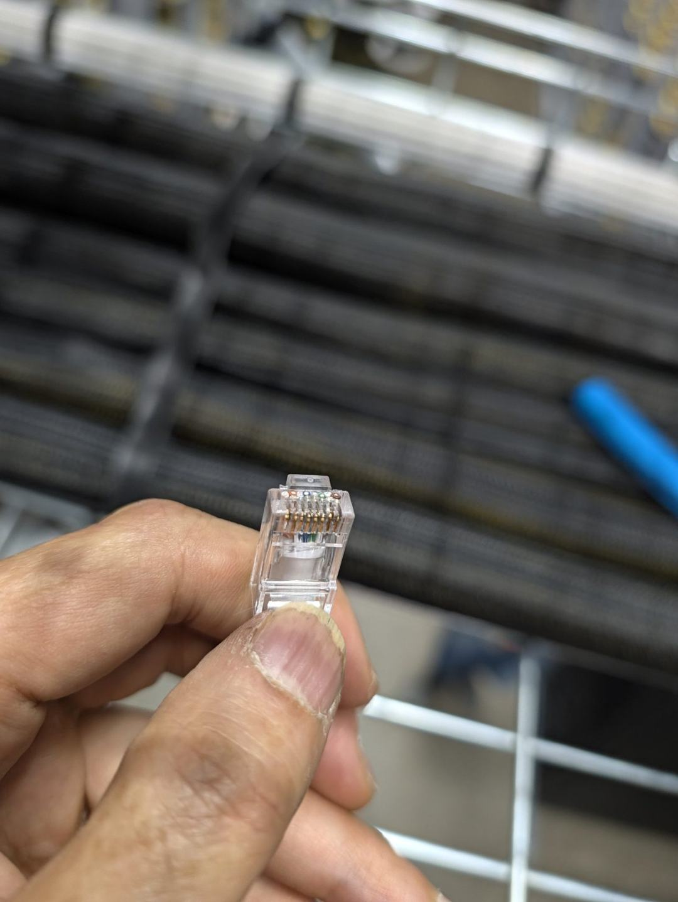
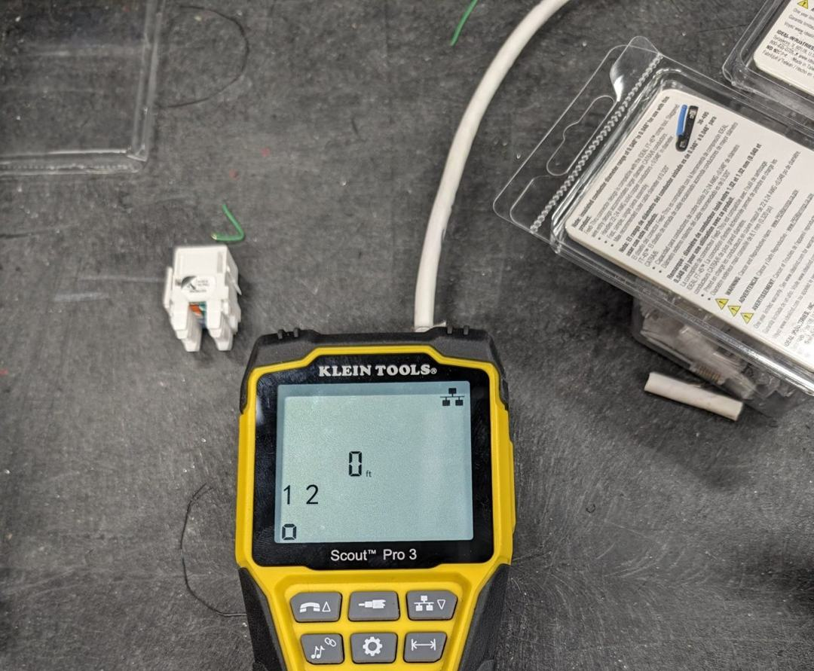

# 实操课：监控摄像头现场端接与上电前测试——通孔水晶头、软管进线与测线仪验收

_Field Practice: Camera-Side Cat6 Termination with Pass-Through Plugs, Liquidtight Drops, and Pre-Power Testing_

> 本课接《实操课：监控系统设计与施工》与《实操课：水晶头、母头与寻线器》之后，只讲**摄像头这一头的现场收尾**：线从桥架下来，怎么走软管、怎么端接、怎么测、怎么交付。素材全部来自真实工地照片（已脱敏，点位编号为通用代号 CAM-xx，现场按本项目编号表执行）。
>
> 一句话主线：**端接质量在压钳响之前就决定了；测试不过，绝不上电。**

---

## 1. 先看全景：摄像头端的链路（Camera-Side Overview）



数据中心里的摄像头多为吊装，两种最常见的形态：

- **桥架下吊装**：横担（strut）＋吊杆把摄像头挂在桥架下方，一排点位共用一根横担；
- **结构/管道下吊装**：借现有结构件下吊，线缆从桥架经软管下引到机身。



链路只有一段，却最容易出问题：

```
桥架主干线束 ──▶ 软管下引 ──▶ 摄像头（端接 + PoE 上电）
```

照片 1 中间那根垂着的白线就是**未收尾状态**：线放到了、头也打了，但没入管、没固定、没测试。交付验收时这种状态一律不算完成。

---

## 2. 走线与软管：最后一段必须有保护（Liquidtight Drop）



- 桥架出线口到摄像头进线口之间，线缆**必须套液密软管（liquidtight flexible conduit）**：防桥架毛刺割伤、防拉扯、防日后检修拖拽；
- 软管两端固定牢靠，弯曲半径自然，不打死弯、不吊在半空晃；
- 桥架内线束用**魔术贴**绑扎（不用尼龙扎带勒线，扎带过紧会压伤线对、影响性能）；
- 摄像头进线前留一圈**检修余量（service loop）**：日后换机身、换头不用重新放线；
- 软管内穿几根线按点位表来，穿完两头再核对一遍临时标记，别等端接完才发现穿串了。

---

## 3. 剥线与分对：先分开，不急着解绞（Strip & Separate Pairs）



1. 剥线器环切外皮，剥长约 4–5 cm，手感要轻——**环切伤芯是隐形故障的头号来源**，剥完先逐根看一遍铜芯有没有刀痕；
2. 剪掉撕裂丝/填充十字骨架（Cat6 有骨架时贴根剪净）；
3. 四对先分开成扇形，**此时只解开每对靠近根部的少许**，不要整段解绞——双绞的绞距就是抗干扰性能，解开多少丢多少。

---

## 4. 理线序：T568B 一次排对（Order the Conductors, T568B）



全场统一 **T568B**，从左到右背下来：

| 脚位 | 1 | 2 | 3 | 4 | 5 | 6 | 7 | 8 |
|---|---|---|---|---|---|---|---|---|
| 颜色 | 白橙 | 橙 | 白绿 | 蓝 | 白蓝 | 绿 | 白棕 | 棕 |
| 对 | 橙对 | 橙对 | 绿对 | 蓝对 | 蓝对 | 绿对 | 棕对 | 棕对 |

手法要点：

- 每对解绞后立刻用指腹把芯线**捋直**，波浪线穿头必歪；
- **解绞长度越短越好**：从外皮口到端接点的裸绞外段控制在约 13 mm 以内，贴根理线；
- 八根排齐后整体比一次长短，**剪齐端头**再穿头，长短不一会有的先顶到、有的悬空。

---

## 5. 穿头：通孔式水晶头的正确用法（Pass-Through Plug）



通孔式（pass-through / EZ）水晶头是现场端接的首选，原因只有一个：**压之前能验线序**。

1. 把排好序的八根线平直送入头体，一直顶到全部从前端穿出；
2. **压钳之前，先从头部正面逐根念一遍颜色**：白橙、橙、白绿、蓝、白蓝、绿、白棕、棕——不对就抽出来重排，这一步 10 秒钟，省一次返工上梯子；
3. 确认**外皮顶进头内**：线缆外皮要进入头体尾部、被压片压住，只压住八根细芯的头，插拔两次就松脱；
4. 一只手保持线束不回缩、不旋转，另一只手送钳。

---

## 6. 压接与修齐：压完还要"三看"（Crimp, Trim & Inspect）



- 用**通孔式专用压线钳**：一次动作同时完成压接＋切齐前端余线；
- 用普通钳压通孔头时，压完必须再用齐平剪把前端余线贴根剪净——**余线伸出长短不一，相邻铜线可能搭接短路，还会顶住端口插不到底**；
- 压完"三看"：① 前端铜线齐平、不露毛刺；② 八个金色触点全部压到位、高度一致；③ 尾部压片咬住外皮，轻拉线束不滑动。

---

## 7. 上电前测试：测线仪三件事（Pre-Power Testing）



端接完成**不等于**可以上电。接 PoE 之前，用测线仪过三件事：

| 测什么 | 怎么测 | 合格标准 |
|---|---|---|
| 线序与通断 | 主机接这头，**远端头（remote）**拔下来接另一头，按"网络"键测 | 8 芯全通、无开路/短路/错线/串对 |
| 长度 | 同一屏读出（也可单独按长度键） | 与放线记录大致吻合，异常短＝中间断点，异常长＝盘线没展完 |
| 认线（多根同测时） | 换不同编号的远端头，主机读出编号 | 屏幕编号与这根线两端标签一致 |

配套要点：

- 远端头平时就收纳在主机底部抽屉里，用完立刻归位——丢了它整台表只剩半条命；
- 线序测不过先回第 4–6 节查：多数问题出在**一头 A 序一头 B 序、某根没顶到、余线搭接**，按顺序排，别乱剪；
- 桥架上一束线分不清谁是谁时，测线仪的 **Tone 模式发信号＋感应探头**寻线复核（方法见寻线器专课）；
- **红线：测试和端接时，线缆两头都不得连着在电设备。** PoE 交换机口、已上电的摄像头都先断开；测线仪带电压报警，屏幕出现电压警告立即停手查线——带电误测轻则数据作废，重则烧表烧端口。

---

## 8. 常见错误对照（Common Mistakes）

| 现象 | 多半是什么错 | 回到哪一步 |
|---|---|---|
| 测序 3、6 不通或交叉 | 绿对有一根没顶到 / 两头标准不一致 | 第 4、5 节 |
| 整段不通 | 外皮剥伤芯线断在根部 / 压接没压到位 | 第 3、6 节 |
| 时通时断 | 只压住细芯、外皮没进头，插拔后松脱 | 第 5 节 |
| 长度显示远短于实际 | 中间被压伤、踩伤的暗断 | 第 2 节走线复查 |
| 一插交换机就跳电/报警 | 线上有电误测，或余线搭接短路 | 第 6、7 节 |
| 画面有了但频繁掉线 | 解绞过长、串对（split pair），测线仪简单通断测不出，要看串对报警 | 第 4 节 |

---

## 9. 交付检查清单（Sign-off Checklist）

- [ ] 软管全程护线、两端固定，检修余量已留
- [ ] 两端标签与点位表一致（摄像头端＋配线架端）
- [ ] 测线仪线序合格、长度已记录，远端编号对上
- [ ] 头部"三看"通过，前端余线齐平
- [ ] 断电状态完成全部测试后，才接 PoE 上电
- [ ] 上电后看画面：角度覆盖点位要求、无抖动无遮挡
- [ ] 临时手写标记换成正式标签，垂线、散线全部收尾

> 记住本课的顺序感：**先保护（软管），再端接（线序压前验），后测试（不过不上电）。** 三步不错位，摄像头这一头就不会成为返工名单上的常客。
