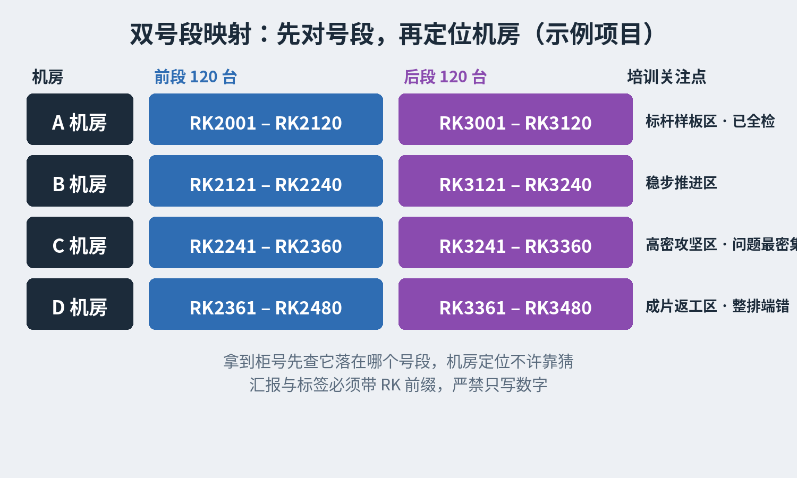
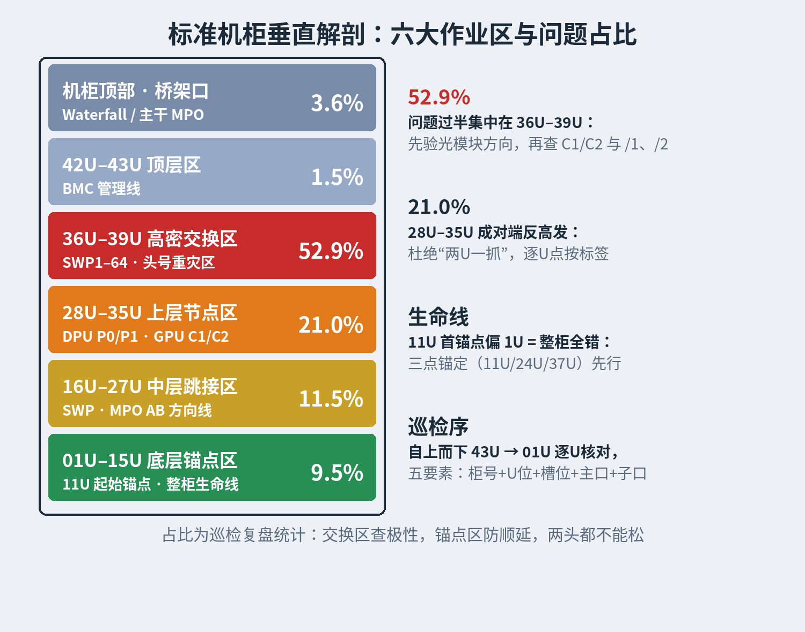
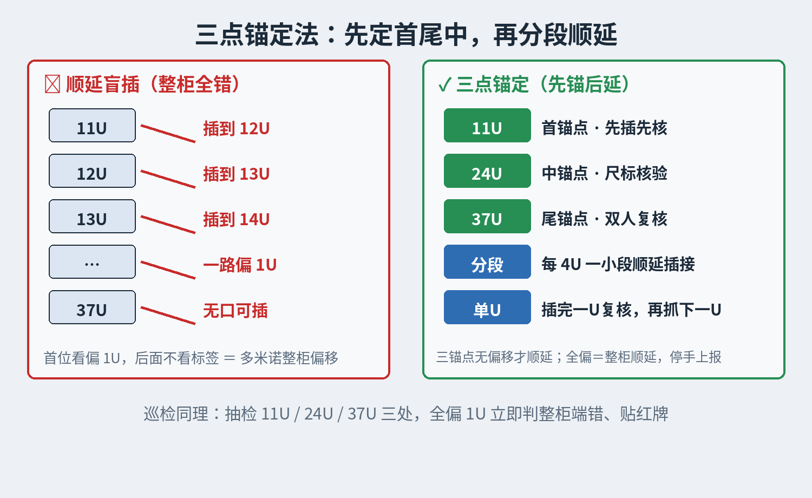
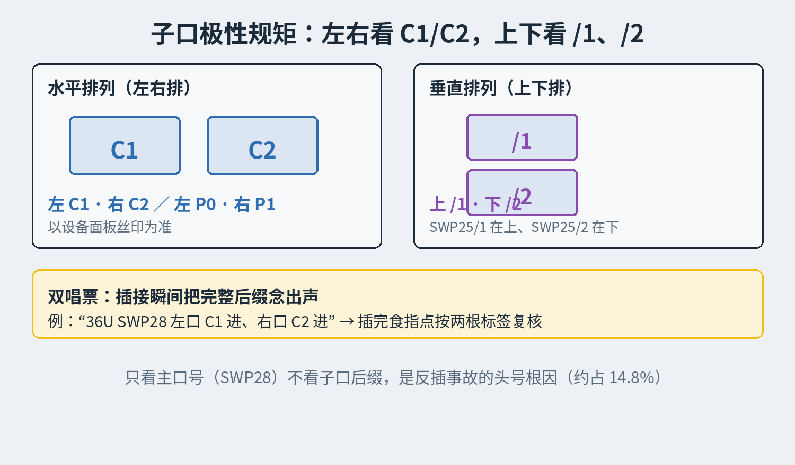
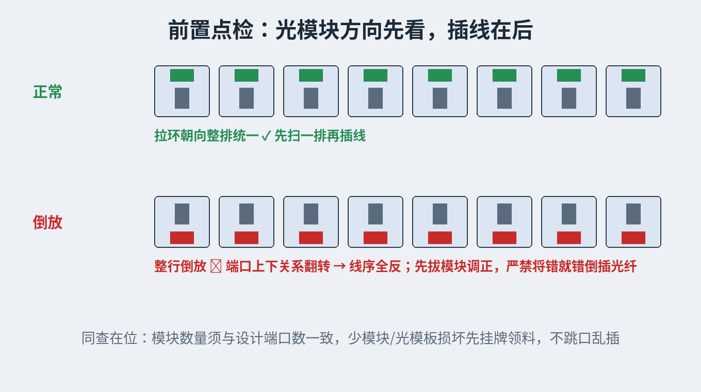
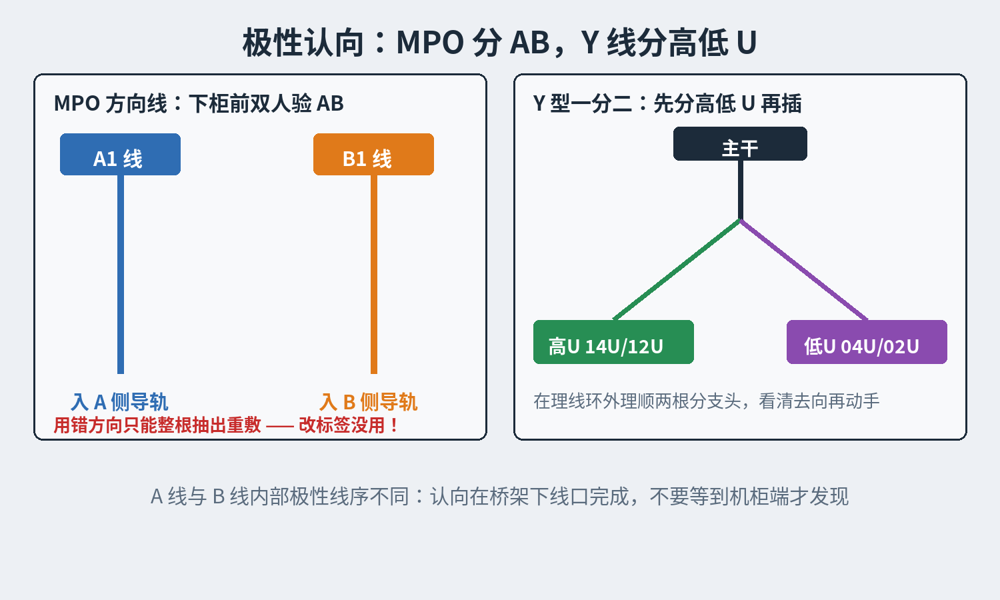
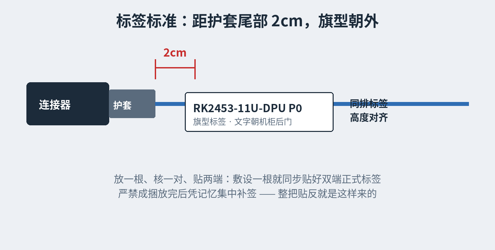
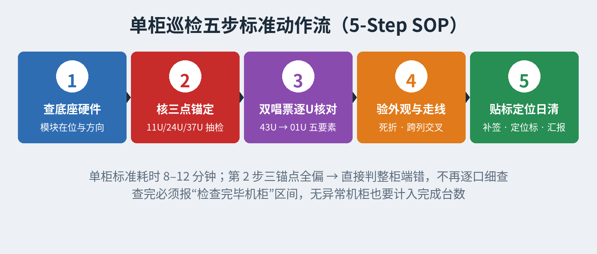
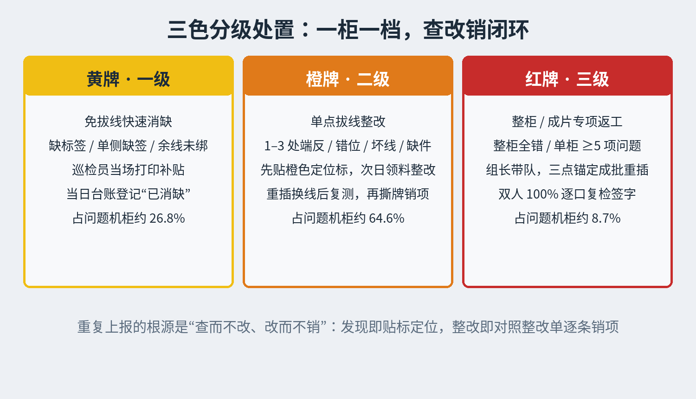

# 实操课：机柜线缆端接与标签巡检——六大防错铁律、五步巡检法与三色闭环

*Field Practice: Rack Cabling Termination & Label Inspection — Six Error-Proofing Rules, 5-Step Inspection SOP, and Three-Tier Closure*

> 本课由真实项目巡检复盘整理：连续 9 个巡检日、已检机柜 523 台、三百余项独立隐患，归并成"六大实操防错铁律＋晚班巡检五步法＋三色分级闭环"。按培训发布要求已脱敏——机房以 A/B/C/D 代称，机柜号段、日期与总量均为教学示例值；问题类型占比与处置方法为真实经验提炼，现场执行以本项目图纸与编号表为准。
>
> 一句话主线：**错位大多不是手艺问题，是顺序问题——先锚定、再顺延；先点检、再插线；先理顺、再绑扎。**
>
> 培训目标：实现**"零整柜顺延端错、零极性反插、零方向线误用、零跨日重复漏改"**四大质量目标。适用对象：布线施工员、理线绑扎员、晚班标签与线缆巡检员、整改返工班组长、现场质检员。

---

## 第一章：机房全局架构与标准命名规范（新员工入场必修）

### 1.1 机房物理分区与"前段+后段"双号段映射规则

以一个教学示例项目说明读法：共 4 个示例机房、总计 960 个标准机柜位。每个机房固定容纳 240 台机柜，由"前段 120 台"与"后段 120 台"对称组成，前后两段在编号上分属两个连续号段。所有入场人员必须熟记各机房号段归属，严禁跨区报错机柜位置：

| 示例机房 | 前段机柜号范围 (120台) | 后段机柜号范围 (120台) | 设计容量 | 已检基线 | 问题机柜数 (需拔线) | 机房现场作业状态与培训关注点 |
|:--- |:--- |:--- |:---: |:---: |:---: |:--- |
| **A 机房** | `RK2001 – RK2120` | `RK3001 – RK3120` | 240 台 | **240 台 (100.0%)** | 2 台 (0台) | **标杆样板区**：已 100% 全检收官，仅 `RK3051`、`RK3060` 两处轻微项 |
| **B 机房** | `RK2121 – RK2240` | `RK3121 – RK3240` | 240 台 | **113 台 (47.1%)** | 24 台 (9台) | **稳步推进区**：注意 `RK2236`（37U 光模板损坏）须先修复再绑线 |
| **C 机房** | `RK2241 – RK2360` | `RK3241 – RK3360` | 240 台 | **108 台 (45.0%)** | 55 台 (48台) | **高密攻坚区**：问题最密集，含 `RK2281`(12项)、`RK2299`(10项)、`RK2291` |
| **D 机房** | `RK2361 – RK2480` | `RK3361 – RK3480` | 240 台 | **62 台 (25.8%)** | 46 台 (35台) | **成片返工区**：含 `RK2451–RK2458` 连续整排 DPU 端错重灾区 |
| **全项目合计** | `RK2001 – RK2480` (480台) | `RK3001 – RK3480` (480台) | **960 台** | **523 台 (54.5%)** | **127 台** | **Waterfall 走线槽**：已装约二百余个，余约五百个 |

### 1.2 机柜、U位、槽位与设备端口标准命名语法

在打印标签、手写巡检单及群内汇报时，必须严格使用统一语法，杜绝因命名混乱导致整改班组找不到端口：

1. **机柜编号语法**：统一使用大写 **`RK` + 阿拉伯数字**（如 `RK2453`、`RK3460`）。现场手写或口头汇报严禁省略 `RK` 前缀。
2. **高度 U 位与左右槽位语法**：
* 垂直高度统一写作 **`数字 + U`**（如 `11U`、`36U`、`39U`）；连续区间写作 **`起始U–终止U`**（如 `11U–37U`）；成对对调位置写作 **`14U↔15U`**。
* 高密度服务器节点内部包含左右/上下子槽位时，必须在 U 位后注明 **`A1 / A2 / B1 / B2`**（例如：`RK2348 14U A1`、`RK2349 30U A2`、`RK3460 12U–21U B1/B2`）。
3. **五类核心设备端口标准写法与防笔误红线**：
* **SWP（交换机端口）**：占全项目问题的 **52.9%**。标准格式为 `SWP + 端口号 + 子口后缀`，子口分为上下排斜杠型（如 `SWP25/1`、`SWP25/2`）和左右排 C 型（如 `SWP4 C1`、`SWP4 C2`）。****：严禁将数字 `1` 误写为英文字母 `I`（如前期 `RK3460 22U swp4 CI和C2接反` 中的 `CI` 必须规范写作 `C1`）。
* **DPU（数据处理单元端口）**：占全项目问题的 **22.4%**。标准格式为 `DPU P0`、`DPU P1`。必须严格区分同一节点上的 `P0` 口与 `P1` 口，不得笼统写成"DPU线反"。
* **GPU（图形计算节点端口）**：占全项目问题的 **15.7%**。标准格式为 `GPU0`、`GPU1`、`GPU2`、`GPU3` 配合 `C1 / C2` 子口（例如：`GPU3 C2 与 GPU2 C2 端反`）。
* **BMC（带外管理网口）**：占 **1.5%**，主要位于机柜顶部 `42U / 43U`（例如：`RK2452 43U BMC 与 42U BMC 端反`）。
* **桥架特殊线标识**：非单柜内部端口、位于机房上方走线架的主干光缆，需注明桥架号与完整线缆编码（例如：`TR-3桥架 线标识88.1.1~88.1.6`）。

---

## 第二章：标准机柜垂直 U 位解剖与高频错位风险地图（看图识柜）

施工员与巡检员站立在机柜后侧（背板理线面）时，必须建立清晰的"垂直空间坐标感"。以下按自上而下（机柜顶 → 01U）拆解六大作业区的结构特征与常见失误：

| 机柜垂直区段 | 核心部署设备与线缆类型 | 历史问题占比 | 现场高频错位模式与真实警示案例 | 施工与巡检重点核查动作 |
|:--- |:--- |:---: |:--- |:--- |
| **机柜顶部及桥架口** | Waterfall 走线槽、TR-3 桥架下柜主干线、MPO 预端接线缆 | 3.6% | • `TR-3桥架 88.1.1~88.1.6` 共 5 根主干线两头标签贴反 • `RK2338` 新下线因弯曲半径过小或牵引碰撞坏 2 个接头 | 核验 Waterfall 卡扣稳固度与导纤弧度；主干光缆下柜前先双端对号，严禁死折硬拽 |
| **42U – 43U 顶层区** | BMC 管理交换机 / 顶层管理节点 | 1.5% | • `RK2452` 43U BMC 与 42U BMC 上下端反 | 逐一核对顶层 42U 与 43U 管理线标签，防止顶层高处视线盲区漏检 |
| **36U – 39U 高密交换区** | 核心/TOR 高密度交换机（`SWP1 ~ SWP64`） | **52.9%** | • `RK2281` 36U↔39U 多达 10 处跨 U 错位与 C1/C2 反插 • `RK2291` 36U 连续 5 组端口（SWP28/29/30/33/34）全部 C1/C2 接反 • `RK2310` 光模块倒放两行导致 SWP11–32 线序全反 • `RK2236` 37U 光模板损坏导致无法绑线 | **头号重灾区**：① 先验光模块正反方向；② 严查上下口 `/1`与`/2`、左右口 `C1`与`C2`；③ 重点排查 `36U↔39U` 跨层跳接 |
| **28U – 35U 上层节点区** | 计算服务器上段（`DPU P0/P1`、`GPU0~3 C1/C2`） | 21.0% | • `RK2451`、`RK2452` 在 28U↔29U、30U↔31U、32U↔33U、34U↔35U 连续成对端反 • `RK2452` 28U–31U DPU P0/P1 乱端 • `RK2349` 30U A2 GPU1 C2 与 GPU0 C2 端反 | 杜绝"两U一抓"；每插完 1U 必须手指点按 P0、P1 标签确认无上下颠倒、无左右反插 |
| **16U – 27U 中层跳接区** | 中层交换机（`SWP`）、`A1/B1` 分流线束、MPO `AB` 方向线 | 11.5% | • `RK2325` 16U SWP33 之后不同列线缆跨列交叉（绑后会拧劲） • `RK2340` 24U SWP12 C2 将 `A1` 方向线误用在 `B1` 位置 • `RK3309` 39U/37U SWP53 整把线两头标签贴反 | 分列理线（左A右B）；敷设 MPO 方向线必查 `A1/B1` 极性；未核对严禁扎死尼龙扎带 |
| **01U – 15U 底层锚点区** | 计算服务器下段（`11U` 起始锚点）、底层 `Y` 型分支线 | 9.5% | • `RK2453–RK2458` 因起始端错导致 `11U–37U` 整柜 DPU 全部端错 • `RK2359` 14U GPU一排少 2 个光模块 • `RK2352` 14/12 B1 与 04/02 B1 的 SWP18 C1 Y 线端反 | **整柜防错生命线**：11U 作为起始首锚点必须双人复核；核查 14U 光模块在位率及底层 Y 线分支对应关系 |

---

## 第三章：布线端接与贴签"六大实操防错铁律"（施工班组核心教程）

通过对前期三百余项独立隐患进行根因剖析，**接线问题（约占 72.5%）**与**标签问题（约占 20.3%）**合计占比达 **92.8%**。全体布线与整改施工员在作业中必须无条件执行以下六条铁律：

### 铁律一：连续服务器节点"11U / 24U / 37U 首尾中三点锚定法"（严防整柜全错）

* **痛点背景**：在 D 机房一次巡检中，发现 `RK2453`（11–37U）、`RK2454`（11–35U）、`RK2455`（11–37U）、`RK2457`（11–14U 及 18–37U）、`RK2458`（11–37U）连续 5 台机柜的 `DPU P0/P1` 端口全部端错；C 机房 `RK2271` 亦出现 `SWP9–12` 共 9 组 72 根线全错。根因均为施工员在起始位看偏 1U（如将 11U 线插在 12U），随后不看标签顺延盲插，引发"多米诺骨牌式"整柜偏移。
* **标准实操动作**：
  1. **先定三锚点**：在端接 `11U–37U` 连续节点前，严禁从 11U 开始闷头顺插！必须先从线束中找出 **`11U`（首锚点）、`24U`（中锚点）、`37U`（尾锚点）** 三处位置的线缆先行插入对应端口。
  2. **双人尺标核验**：对照机柜立柱 U 位刻度尺，确认首、中、尾三处位置无任何偏移后，再将中间区段按"每 4U 一小段"分步插接。
  3. **单U闭环禁双抓**：插接相邻 U 位（如 `11U` 与 `12U`、`13U` 与 `14U`）时，必须"插完 11U 的 P0/P1、复核无误后，再去抓 12U 的线"，彻底杜绝 `RK2451`（9 对 DPU 成对端反）与 `RK2452`（7 对 DPU 成对端反）式的"两U一抓交叉盲插"。

### 铁律二：同设备双端口"主口+子口双唱票法"（严防 C1/C2 与 P0/P1 反插）

* **痛点背景**：全周期共发生近 **50 项（约占 14.8%）** 同设备内部子端口反插事故，典型如 `RK2291 36U` 连续 5 组交换机口（`SWP28/29/30/33/34`）全部 `C1/C2` 接反、`RK2355 34U DPU P1/P0` 反端、`RK2348 13U/14U A1 GPU3 C2 与 GPU2 C2` 端反。根因是施工员只看了机柜号和主设备号（如只看 `SWP28`），忽略了尾缀 `C1/C2` 或 `/1、/2`。
* **标准实操动作**：
  1. **先认极性规矩**：插线前先确认设备面板丝印——水平排列端口遵循**"左 P0 右 P1 / 左 C1 右 C2"**（以设备面板正视标识为准）；垂直双排端口遵循**"上 /1 下 /2"**。
  2. **双唱票指读确认**：插接瞬间必须默念或双人唱票完整后缀（例如：*"36U SWP28 左口 C1 进、右口 C2 进"*），插完后立即用食指并排点按左右两根线缆标签，确认左 C1、右 C2 绝无颠倒。

### 铁律三：光模块方向与硬件在位"前置点检法"（严防模块倒放与漏件）

* **痛点背景**：`RK2310`（34U 等）因交换机**光模块倒放两行**，导致施工员按常规方向插线后 `SWP11–32` 多端口上下全部接反；`RK2359 14U GPU 一排`少 2 个光模块；`RK2236 37U` 光模板损坏导致无法绑线。
* **标准实操动作**：
  1. **插线前先扫模块**：在将光纤插入任何一台交换机或 GPU/DPU 节点前，必须先用手电筒横向扫视整排光模块：① 核对光模块拉环（解锁扣）朝向是否上下统一；② 核对光模块数量是否与设计端口数一致。
  2. **缺件/倒放先处置**：发现光模块倒放的，立即拔出光模块调正方向后再插光纤；发现少光模块或光模板损坏的，立即挂牌上报领料补装，严禁跳口乱插。

### 铁律四：Y 型一分二线缆与 MPO AB 方向线"极性认向法"（严防整根拆换）

* **痛点背景**：`RK2340 24U SWP12 C2` 将 `A1` 方向线误用在了 `B1` 位置；`RK2352` 将 `14/12 B1` 与 `04/02 B1` 的 `SWP18 C1 Y 型线`端反。由于 MPO AB 方向线内部光纤线序极性不同，一旦用错方向，**无法通过改标签或仅拔机柜端解决，必须从桥架整根抽出重新敷设**，返工代价极大。
* **标准实操动作**：
  1. **桥架下线口验 AB**：敷设 MPO 预端接光缆时，在下柜进入 Waterfall 走线槽前，必须双人核对线身编码的 **`A1 / A2 / B1 / B2` 方向标识**，确保 A 线入 A 侧导轨、B 线入 B 侧导轨。
  2. **Y 型线先分高低 U**：端接 Y 型一分二线缆时，先在理线环外将两根分支头理顺，看清哪一根去高 U 位（如 `14U/12U`）、哪一根去低 U 位（如 `04U/02U`），严禁整组 Y 线上下颠倒插接。

### 铁律五：标签粘贴"放一根、核一对、贴两端"标准法（严防整把贴反与漏签）

* **痛点背景**：全周期共检出**六十余项标签问题（约占 20.2%）**，包括 `RK3309 37U/39U SWP53` **整把线两头标签贴反**、`TR-3 桥架 88.1.1~88.1.6` 共 5 根主干线两头贴反，以及 `RK3030`、`RK3161`"一头有标签、另一头无标签"。根因是施工员违规采取"先成捆放完线，最后凭记忆集中贴标签"。
* **标准实操动作**：
  1. **严禁集中后补签**：放线作业必须执行**"敷设一根、通光/对号一对、本端与对端同步贴好正式标签"**。
  2. **2cm 对齐可视标准**：所有线缆标签统一粘贴在**距连接器护套尾部 2cm 处**，旗型标签文字朝向机柜后门正视方向，保持同一排端口标签高度整齐划一，方便巡检员一眼扫视。

### 铁律六："先理顺、后巡检、再绑扎"防拧劲法则（严防跨列交叉与光纤折损）

* **痛点背景**：一次专项排查发现，`RK2325 16U SWP33` 之后不同列线缆存在跨列交叉（一旦绑扎会产生强烈拧劲损伤光纤），`RK3260 02U–08U` 多根线严重交叉影响绑线，`RK2185/2186` LC 线过长未绑。
* **标准实操动作**：
  1. **分列分层入槽**：理线时严格遵循**"左列归左槽、右列归右槽、低 U 走内层、高 U 走外层"**，不同列的线束在垂直理线架内严禁相互穿越。
  2. **未检严禁扎死**：在晚班巡检员未完成该机柜端接与标签 100% 核对前，理线员仅允许使用**魔术贴（扎线带）临时轻束**；待巡检确认"零错位、零跨列交叉"后，方可正式绑扎定型，并将余长规范盘留在盘纤环内。

---

## 第四章：晚班巡检"五步标准作业法（5-Step SOP）"与汇报规范（巡检员教程）

### 4.1 巡检员入场前"四件套"准备

每晚进入机房巡检前，巡检小组须检查随身工具包：

1. **强光变焦手电筒**（用于照亮 36U–43U 深处子口丝印及光模块方向）；
2. **便携式热转印标签机 + 耗材**（遇到单侧缺标签时当场打印补贴，实现"免拔线当场消缺"）；
3. **红/橙/黄三色定位贴纸 + 油性记号笔**（发现错位口立即贴标定位，防止次日重报或漏改）；
4. **《各机房设计端口拓扑表》与《按机柜汇总整改单》**（用于核对设计线序与复核前期问题是否已销项）。

### 4.2 单柜巡检"五步标准动作流（5-Step Inspection SOP）"

巡检员面对每一台机柜时，严格按以下 5 个步骤顺序作业（单柜标准耗时约 8–12 分钟）：

* **第 1 步**：手电筒先扫视 36U–39U 交换机及 11U–37U 服务器的光模块在位情况与正反方向（防 `RK2310` 模块倒放、`RK2359` 少光模块、`RK2236` 光模板损坏）。
* **第 2 步**：抽检 `11U`（首）、`24U`（中）、`37U`（尾）三处服务器的 `DPU P0/P1` 端口标签。一旦发现这三处全部偏离 1U，立即判定为"整柜顺延全错"（如 `RK2453–RK2458`），无需再逐口细耗时间，直接贴红牌转整柜返工。
* **第 3 步**：若三点锚定正常，则从 `43U BMC` 向下逐 U 核对至 `01U`。手指必须逐一触碰每根线缆标签，核对**"RK柜号 + U位 + A/B槽位 + 主口 + 子口(C1/C2、P0/P1、/1与/2)"**五要素，重点细查 `36U–39U` 交换机密集区及底层 Y 型线。
* **第 4 步**：检查连接器根部是否有死折或外皮破损（防 `RK2338` 坏线），检查垂直理线槽内是否存在跨列交叉（防 `RK2325/3260` 拧劲）。
* **第 5 步**：对免拔线的缺签项当场补打标签；对需拔线的错位项在尾套贴挂橙色定位标（注明正确目标口，如 `RK3472 26U SWP55 端接错位已标记`）；完成整柜后在汇报单记录。

### 4.3 巡检日报"五要素"规范填报模板（正误写法对比）

为确保每日巡检数据能被精准统计入库，巡检员在微信群/工作群或纸质单据汇报时，必须遵循以下规范：

| 常见不规范汇报写法（严禁） | 标准化规范汇报写法（强制执行） | 规范化整改原因说明 |
|:--- |:--- |:--- |
| `3460机柜 22U swp4 CI和C2接反` | **`RK3460 22U SWP4 C1与C2接反`** | 统一带 `RK` 前缀，大写设备名，严禁把数字 `1` 写成字母 `I` |
| `2216机柜 gpu0 c1少了一组线` | **`RK2216 14U A1↔13U A2 GPU0 C1 缺1根Y型线`** | 必须写明具体 U 位、A/B 槽位及所缺线缆规格，避免与前期记录混淆 |
| `3430机柜 swp5 C2少标签` | **`RK3430 22U/24U SWP5 C2 均少本端标签（对端有）`** | 写明涉及的所有 U 位及单/双端缺签状态，方便补签员直接定位 |
| `2452 U31 30 29 28乱端` | **`RK2452 28U–31U DPU P0、DPU P1 端口乱端`** | U 位区间按从小到大书写（`28U–31U`），并写全端口名称 |
| 只发问题列表，不报正常完成机柜 | **`检查完毕机柜：RK3451–RK3460（共10台，其中9台无异常）`** | **极其重要**：不报完成区间会导致机房总完成率（如 523 台/54.5%）漏算无异常机柜！ |

---

## 第五章：现场问题"三色分级处置"与防重复上报闭环机制（班组长教程）

### 5.1 六组重复上报案例教训复盘

在连续 9 天的巡检周期内，共拦截了 **6 组同日或跨日重复上报记录**：

1. **`RK2091 39U SWP54/1,2、53/1,2 上下反`**：首次上报后因现场未贴标识、未及时拔线，次日被再次上报。
2. **`RK2173 27U SWP39/0 线坏了`**：同一天被两名巡检员重复上报 2 次。
3. **`RK3245 18U SWP20、21、22 上下端接错位`**：同一天群内分段汇报时重复粘贴 2 次。
4. **`RK2231 39U SWP31/1 缺标签`**：检出后未当场补贴，4 天后复核时再次检出。
5. **`RK3401 36U SWP47 / SWP49 端接错位`**：检出后未拔线整改，6 天后再次上报。
6. **`RK2450 39U SWP7/1与7/2 端反`**：检出后未拔线整改，5 天后再次上报。

### 5.2 "三色分级挂牌 + 一柜一档销项"标准闭环流程

为彻底根除"查而不改、改而不销、反复重报"，建立以下三级闭环机制：

| 挂牌等级 | 适用问题范围（占全项目比重） | 现场处置责任人与标准动作 | 销项验收标准（闭环样板） |
|:--- |:--- |:--- |:--- |
| **黄牌（一级）** 免拔线快速消缺 | 无标签、缺单侧标签、余线过长未绑 （共 34 台免拔线机柜，占问题机柜 **26.8%**） | **巡检员 / 跟班贴签员**：核对设计拓扑表后，当场使用便携标签机打印补贴，无需申请停机或拔线。 | 双端标签距尾套 2cm 对齐粘贴，当日直接在台账登记"已消缺"（杜绝 `RK2231` 隔 4 天未贴签现象）。 |
| **橙牌（二级）** 单点拔线/换线/补件 | 单柜 1–3 处端反、错位、坏线、缺线、少光模块 （共 82 台机柜，占问题机柜 **64.6%**） | **整改专班**：巡检员先贴橙色定位标（参照 `RK3472 26U 已标记`）；整改员次日领料（Y线/AB线/光模块）并申请拔线窗口，重插或换线后复测收发光。 | 对照《按机柜汇总整改单》逐条复核，完成后撕除橙牌并在台账注明"已闭环"（参照 **`RK3147` 换线闭环**样板）。 |
| **红牌（三级）** 整柜/成片专项返工 | 整柜 DPU 全错、多组 SWP 全错、单柜 ≥5 项问题 （共 11 台高危机柜：`RK2271、RK2281、RK2299、RK2451–RK2458`，占 **8.7%**） | **技术组长带队**：悬挂红牌严禁绑扎；整柜解开魔术贴，按"11U/24U/37U 三点锚定+双唱票"成批重插。 | 组长与质检员双人 100% 逐口复检签字，在总表更新为"整柜专项闭环"。 |

---

## 第六章：项目人员上岗实操考核试卷与随身核查卡（培训考核工具）

### 6.1 上岗前实操必考通关题（满分 100 分，≥90 分合格上岗）

* ****
**题目**：巡检组今晚分配检查 `RK3060`、`RK3180`、`RK3460` 三台机柜，请立即说出它们分别位于几号机房？
**标准答案**：`RK3060` 位于 **A 机房**（后段号段 `RK3001–RK3120`）；`RK3180` 位于 **B 机房**（后段号段 `RK3121–RK3240`）；`RK3460` 位于 **D 机房**（后段号段 `RK3361–RK3480`）。

* ****
**题目**：你在 `RK2453` 巡检时，发现 `11U` 和 `12U` 的 `DPU P0/P1` 标签全都偏了 1U，此时最省时、最规范的排查动作是什么？
**标准答案**：立即停止逐口慢查，执行**"首尾中三点锚定法"**——直接跳查 `24U` 和 `37U` 的 `DPU P0/P1`；若同样顺延偏离 1U，立即判定为 `11U–37U` 整柜全部端错，悬挂红牌上报整柜拔线重插。

* ****
**题目**：你在 `RK2310 34U` 发现交换机连续两行端口（`SWP11–32`）的线缆上下全部接反，申请拔线重插前必须先核实什么？
**标准答案**：必须先用手电筒检查交换机**光模块是否被倒放安装了两行**！若是光模块装反导致，必须先将光模块拔出调正方向，再核对线序，严禁将错就错把光纤倒插。

* ****
**题目**：在 `RK2340 24U SWP12 C2` 发现施工员把 MPO `A1` 方向线误用在了 `B1` 位置，能不能直接把标签改成 `B1` 了事？为什么？
**标准答案**：**绝对不能！** 因为 MPO `A` 线与 `B` 线内部光纤极性线序不同，只改标签会导致收发光路不通；必须申请拔线，将该根错误的 `A1` 线整根拆出，重新敷设正确的 `B1` 方向线。

* ****
**题目**：在 `RK2325 16U SWP33` 之后发现不同列的线缆跨列交叉在一起，理线工正准备用尼龙扎带扎死，你该怎么做？
**标准答案**：**立即制止绑扎！** 跨列交叉的线束一旦扎死会产生扭拧应力折损光纤；必须先申请拔出交叉线缆，按"左列归左、右列归右"重新理顺插好并经巡检合格后，方可绑扎。

* ****
**题目**：你今晚检查了 `RK3451` 到 `RK3460` 共 10 台机柜，其中 `RK3451–RK3459` 全部正常，仅 `RK3460` 有 2 处问题，群内汇报时应怎么写？
**标准答案**：必须分两部分完整汇报：① 逐条写明 `RK3460` 的 2 处具体问题（带 `RK` 前缀、U位、完整端口名、现象）；② 明确写上**"检查完毕机柜：RK3451–RK3460"**，确保 9 台无异常机柜计入机房累计完成台数。

### 6.2 班前会每日必背"两段式防错口诀"

> ****
> 机房号段记心间，先看模块正与反；
> 十一二四三十七，首尾锚定再顺延；
> 主口子口双唱票，左一右二不混淆；
> Y 线 AB 认方向，未检严禁先扎牢。

> ****
> 机柜统一带 RK，U 位槽口写全名；
> C1 勿作 CI 写，发现错位先贴标；
> 免拔当场补好签，拔线入表逐柜销；
> 完成区间随手报，一柜一档日日清。

### 6.3 单柜巡检与整改交接随身核查卡（可打印贴于巡检板夹）

| 核查序 | 核查部位与区段 | 现场必检动作与合格判据（源自三百余项实测案例库） | 自检结果 | 复核人签字 |
|:---: |:--- |:--- |:---: |:---: |
| **01** | **顶部走线槽与桥架口** | Waterfall 走线槽安装平直无压纤；TR-3 桥架下柜线双端标签一致、AB 极性正确 | `□合格 □异常` | `________` |
| **02** | **42U–43U BMC管理区** | 42U 与 43U BMC 管理线上下位置一一对应，无交叉端反（防 `RK2452` 类错误） | `□合格 □异常` | `________` |
| **03** | **36U–39U 交换机底座** | 光模块全部在位且方向一致（防 `RK2310` 倒放两行）；光模板完好（防 `RK2236` 损坏） | `□合格 □异常` | `________` |
| **04** | **SWP1–64 端口极性** | 上下口（`/1`与`/2`）及左右口（`C1/C2`）零反插，双端标签距尾套 2cm 对齐 | `□合格 □异常` | `________` |
| **05** | **11U/24U/37U 三锚点** | 连续服务器区首、中、尾三处基准 U 位锚定准确，无顺延偏移 1U（防 `RK2451–RK2458` 整排端错） | `□合格 □异常` | `________` |
| **06** | **11U–37U DPU/GPU区** | 相邻 U 位 `DPU P0/P1` 无成对端反（防 `RK2451/2452`）；同层 `GPU C1/C2` 及光模块齐全 | `□合格 □异常` | `________` |
| **07** | **01U–27U Y线与走线** | Y 型线分支端无颠倒（防 `RK2352`）；不同列线缆无跨列交叉拧劲（防 `RK2325/3260`） | `□合格 □异常` | `________` |
| **08** | **现场贴标与五要素上报** | 异常口已贴红/橙定位标（如 `RK3472`）；群内已按"RK柜号+U位+端口+现象+完成区间"上报 | `□合格 □异常` | `________` |

---

**使用说明**：本课是培训与施工管理参考，不是任何厂商发布的官方施工标准。具体端口映射、允许力、弯曲半径及测试限值按项目批准文件和对应厂家说明执行；文中机柜编号、号段与统计总量为教学示例，案例类型与处置流程来自真实巡检复盘。
