# 实操课：网线与监控线缆端接——水晶头、母头、寻线器与 UniFi 设备连接

_Field Practice: RJ45 Plugs, Keystone Jacks, Tone & Probe, and UniFi Device Hookup_

> 本课素材全部来自真实工地照片与图纸。学完这一课，你应该能独立完成：一根 Cat6 从放线、编号贴标、两端端接、测通、寻线复核，到跳进交换机点亮摄像机 / AP / 门禁的全流程。
>
> **先立一个总口径：每个机房的摄像头是单独编号的，不同机房之间不连贯。** 每间机房都有自己的一套 80 台：编号 1–48、49–62、71–88（63–70 号不存在），对应位置的编号间间相同。所以"71 号"只在本机房内有意义，标签上必须带机房（接线柜号），见第 7、9 节。

---

## 1. 工具与材料（Tools & Materials）

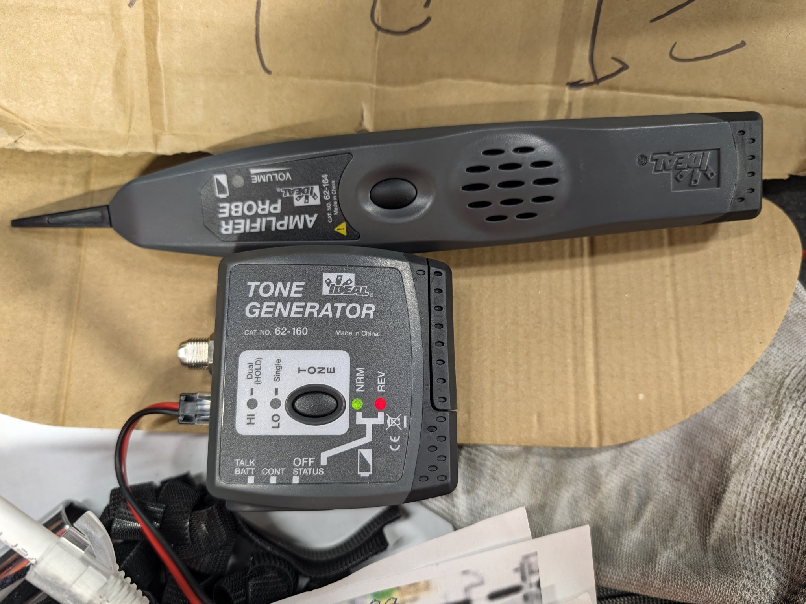

| 中文 | English | 用途 |
|---|---|---|
| 信号发生器 | Tone Generator（IDEAL 62-160） | 往目标线里注入音频信号，供寻线 |
| 感应探头 | Amplifier Probe（IDEAL 62-164） | 靠近目标线时发声，声音最大即目标 |
| 压线钳 | Crimper | 压接 RJ45 水晶头；通孔式水晶头配通孔钳 |
| 剥线器 | Cable Stripper | 环切外皮，不伤芯线 |
| 打线刀 | 110 Punch-Down Tool | 把线芯打入母头 / 配线架 IDC 卡槽并切断余线 |
| 测线仪 | Cable Tester | 测 8 芯通断与线序（1–8 灯序） |
| 认证仪 | Certifier（如 Fluke DSX） | 测串扰、长度、回波损耗等，出正式报告（验收要求时用） |
| 标签机 | Label Printer | 打印正式标签；手写只许用于施工临时标记 |
| 水晶头 | RJ45 Plug | 设备端公头；现场推荐通孔式（pass-through），可从前端验线序 |
| 母头（信息模块） | Keystone Jack | 配线架、墙面插座、AP 尾线端；照片中为 Leviton Cat6 模块 |
| 配线架 | Patch Panel | 机柜端集中端接面板，端口编号与图纸一一对应 |
| 跳线 | Patch Cord | 配线架端口 ↔ 交换机端口之间的短成品线 |

---

## 2. 线序标准：全场统一 T568B

网线和监控线用的是同一种线（Cat6 四对双绞线），打法完全一样。北美商业项目默认 **T568B**，一个项目从头到尾只用一个标准——两端标准不一致就成了跨线（crossover），现在的设备大多能自动识别，但验收和排障都会埋雷，所以不许混用。

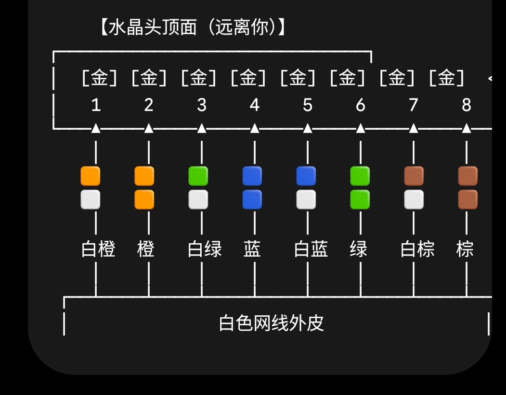

**T568B 针脚表**（水晶头顶面朝外、金属触点朝上，从左到右 1–8）：

| 针脚 Pin | 1 | 2 | 3 | 4 | 5 | 6 | 7 | 8 |
|---|---|---|---|---|---|---|---|---|
| 颜色 | 白橙 | 橙 | 白绿 | 蓝 | 白蓝 | 绿 | 白棕 | 棕 |
| | White-Orange | Orange | White-Green | Blue | White-Blue | Green | White-Brown | Brown |

**为什么 8 芯必须全通：** PoE 供电也走这 8 芯——802.3af/at 的 Mode A 用 1/2、3/6 送电，Mode B 用 4/5、7/8 送电。少接一芯，可能出现"能上网但没电"或"有电不通网"的怪毛病。所以端接没有"只接 4 芯就够了"这回事，8 芯全接、全测。

---

## 3. 打水晶头（RJ45 Plug）——设备端

摄像机、AP 的尾线端常用水晶头公头直插设备。步骤：

1. **剥皮**：剥线器环切外皮约 3–4 cm，抽掉外皮。检查芯线绝缘有没有被刀口划伤，划伤就剪掉重剥。
2. **理线**：四对线逐对解开、拉直，按 T568B 顺序排好：白橙、橙、白绿、蓝、白蓝、绿、白棕、棕。**解绞长度越短越好，不要超过 13 mm（约半英寸）**——解绞越长，近端串扰（NEXT）越差，认证越容易 Fail。
3. **剪齐**：把排好的 8 芯捏紧、前端一次剪齐，保留外皮外约 12–14 mm。
4. **入头**：捏住不松手，整排插入水晶头。通孔式水晶头要让每根芯线从前端孔穿出，**逐根对颜色再确认一次线序**；普通水晶头要确认每根芯线都顶到最前端、从透明头部能看到铜芯端面。
5. **外皮到位**：线缆外皮必须进入水晶头尾部约 5 mm，被压线片压住——这叫应力释放（strain relief）。只压住芯线、没压住外皮的头，用一段时间必松脱。
6. **压接**：压线钳一次压到底，听到/感到棘轮释放。通孔式压完后齐根剪掉前端多余线头（通孔钳自动切齐）。
7. **自检**：轻拽每根芯线不动、拉线身水晶头不脱；目视触点压痕整齐、塑胶弹片完好。
8. **测线**：测线仪两端接好，1–8 灯依次全亮且两端灯序一致，才算合格。不合格剪掉重打，不要将就。

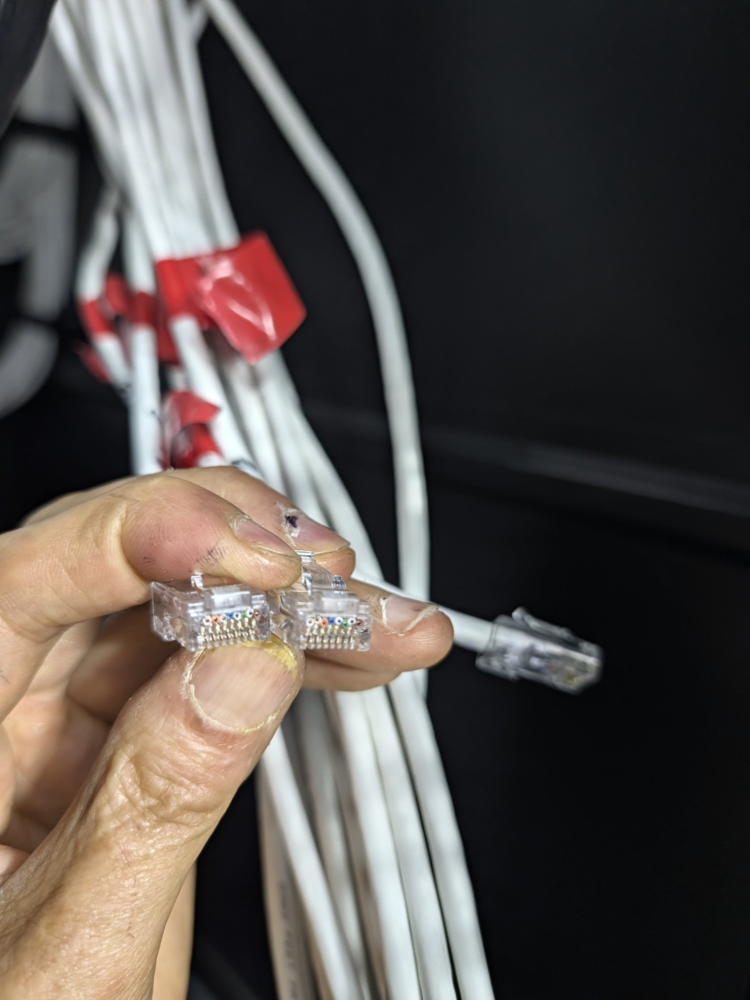

**常见错误**：白绿与绿对调（第 3、6 位最容易错）；外皮没进压片；解绞过长；芯线没顶到头导致某芯虚接（测线仪灯时亮时灭）。

---

## 4. 打母头（Keystone Jack）——配线架与墙面端

机柜端全部打母头上配线架，墙面插座、AP 点位也常用母头加跳线。步骤：

1. **剥皮**：外皮剥约 4–5 cm，比水晶头留长一点，方便在模块上走线。
2. **对色标**：母头侧面印有 A/B 两套色标，**认准 B 标**，把四对线按色标分别卡到对应的 IDC（绝缘位移）槽口上。逐对就位，不要一开始就把四对全解开散放——容易串对。
3. **打压**：打线刀垂直对准槽口，一对一压到底。**刀刃（切线口）朝外侧**，多余线头会被自动切断；方向反了，线头切不断还会留在槽里。
4. **检查**：每根芯线都卡到槽底、铜芯与刀片接触面干净；被切断的余线全部清除（残线头搭到邻芯就是短路）。
5. **盖盖入架**：装上模块后盖/理线盖，把模块卡入配线架，听到"咔哒"到位；线缆在配线架后方留适当余量、用魔术扎带（Velcro）固定，不许用尼龙扎带勒紧线束。
6. **贴标**：在配线架标签条上写清该端口对应的设备编号（标签规则见第 9 节，端口对照见第 7 节）。标签在端接当时就登记，不要攒到最后凭记忆补。
7. **测线**：另一端接测线仪远端，1–8 全通、线序正确。

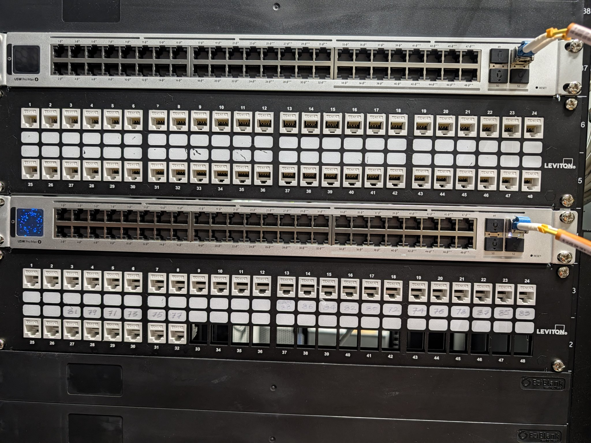

**特别注意 split pair（分岔对）**：一对双绞线被拆开、分别接在两个不同线对的位置上——测线仪灯序全对、通断全过，但双绞被破坏，跑高速必 Fail、认证必挂。只有认证仪能查出来。预防办法只有一个：严格按色标逐对就位，不要"看着颜色差不多"凭感觉排。

---

## 5. 寻线器找线（Tone & Probe）

工具：IDEAL 62-160 信号发生器 + 62-164 感应探头（照片见第 1 节）。用途：几十根线混在一起、标签丢了或怀疑标错了的时候，找出"哪一根是哪一根"。标签彻底乱了时的系统打法见第 12 节，这里先讲工具本身。

**原理**：发生器往目标线里注入一个音频信号，信号沿线缆辐射；探头靠近这根线时扬声器会响，离得越近、声音越响越尖。在另一端逐根试，声音最强的就是目标线。

**发生器设置（按 62-160 面板）**：
- 上部开关拨到 **TONE**；音调选 **Single（单音）** 或 **Dual（双音）**——线束里找线时双音更容易从串音里分辨出来；**HI/LO** 选信号强度，一般先用 HI。
- 面板上的 NRM/REV 两个灯是 STATUS 模式看电话线极性的，找网线不用管。
- **CONT** 档可以粗测一对线的通断（导通会发声/亮灯），只能应急，不能代替测线仪。

**接发生器**：用它的 RJ45 引线插到已知端——比如插进配线架某个端口，或插到摄像机端的尾线水晶头。只有裸线头时，用鳄鱼夹夹住一对线的两根芯（红、黑各一根）。

**探头找线**：
1. 按住探头按钮，音量旋钮（VOLUME）先开大。
2. **先粗后细**：先在线束、桥架上沿走向扫，确认这根线大概走哪条路、在哪一束里；再到目标端逐个端口/逐根线点测。
3. 探头尖**轻触端口金属片或线芯**时信号最强；隔着外皮扫是粗定位，点触确认才是最终认定。
4. 线束里邻线会串音，第二响、第三响的不要急着认——以点触时声音最尖最响的那根为准。

**找到后必做的两件事**：
1. 拔掉发生器，换测线仪测 8 芯通断与线序——**寻线只回答"哪根"，不回答"接得对不对"**。
2. 按图纸端口表贴正式标签，两端都贴。

**注意事项**：不要把发生器接到带强电的线路上；终端设备接着交换机 PoE 时音调可能变调，先把设备端断开再打音更稳妥；发生器开着时不要长时间夹在同一对线上不管，用完拨回 OFF 省电。

---

## 6. 连接 UniFi 交换机、AP、摄像机与门禁

现场设备：Ubiquiti **USW Pro Max** 交换机 + Leviton 配线架。记住标准链路，所有终端都按这个顺序接，不许跳级：

**终端设备 → 水平线缆 → 配线架端口（母头） → 跳线 → 交换机端口 → SFP+ 上行（光纤/DAC）→ 核心交换机 / 网关**

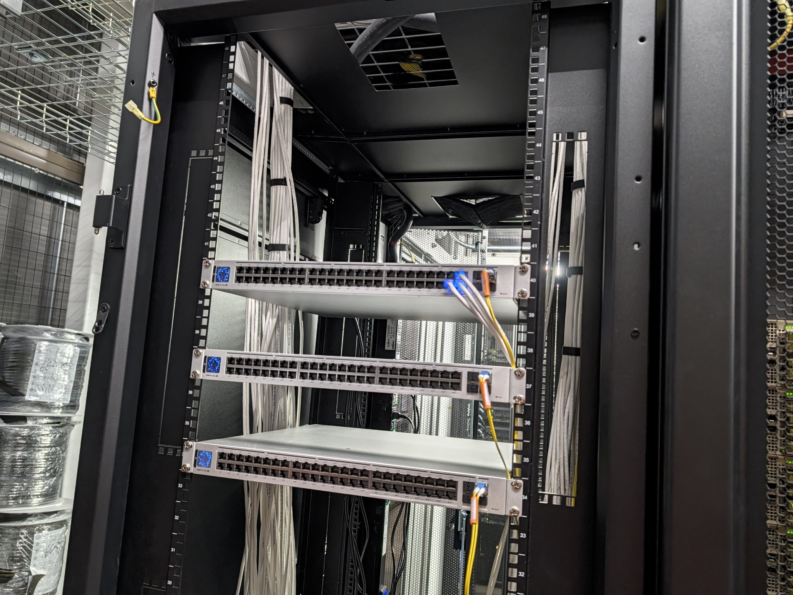

### 6.1 跳线与端口对应
- 跳线只做"配线架端口 ↔ 交换机端口"的一一对应，**不许从交换机直接拉长线去设备**（那样机柜里没法维护、标签体系全乱）。
- 接好后在 UniFi Network 控制器里把交换机端口**改名/备注为设备编号**（如 CAM-71、AP-LOBBY），以后任何人打开控制器都知道每个口后面是谁。

### 6.2 上行（Uplink）
- USW Pro Max 用 SFP+ 口做 10G 上行：光纤模块+光纤跳线（照片里的黄色跳线是单模 OS2），或 DAC 直连铜缆。插拔光模块时手不要碰光纤端面，眼睛不要直视光口。

### 6.3 PoE 供电（关键）
- 摄像机、AP、多数门禁控制器都靠网线 PoE 受电，不用另拉电源。接之前核对三件事：① 设备要哪一级 PoE（802.3af / at / bt）；② 交换机**整机 PoE 预算**（power budget）加起来够不够；③ 控制器里该端口的 PoE 输出有没有打开。
- 参考：固定半球/枪机一般 af/at 足够；带云台、加热器、强补光的摄像机可能要 bt（PoE++）。

### 6.4 UniFi AP
- 网线到 AP 安装点：母头+短跳线，或水晶头直插，按现场做法统一。
- AP 上电后要在 UniFi Network 里 **Adopt（领养）** 才能下发 SSID 等配置；领养前 AP 指示灯为待领养状态。
- 安装前先把 AP 背面的 **MAC/序列号贴纸拍照存档**并和点位编号对应记录——装上吊顶之后就看不见了。

### 6.5 摄像机
- 一根 Cat6 到位，数据+PoE 一根线搞定（本课第 2 节的线序和打法）。
- 布线阶段你的交付标准只有三样：**线对、端口对、标签对**。IP 地址、画面调试归系统调试方，但物理链路错了谁都调不出来。

### 6.6 门禁（Access Control）——和普通网口的区别要分清
以 UniFi Access 一类系统为例：
- **控制器/Hub**：一根网线（数据，部分型号 PoE 供电，部分要单独电源适配器，以手册为准）。
- **读卡器（Reader）**：到 Hub 之间按厂家线序接（OSDP/Wiegand 协议线；有的系统直接用网线代，按手册针脚表接，不要自己 invent 线序）。
- **电锁（Mag Lock / Electric Strike）**：必须走**单独的 12V 电源回路**，锁线线径要按距离核算压降——这是门禁和普通网口最大的区别：锁的电不从网线来（除非是厂家成套的 PoE 门禁套件且手册明确允许）。
- **门磁（Door Contact）、出门按钮（REX, Request to Exit）**：各拉一根线回 Hub 对应端子。
- 强电（锁电源）与弱电（网线、信号线）分开走线、分开桥架格，不与网线同束捆扎。

### 6.7 VLAN 归属
监控、门禁、AP、办公网通常分不同 VLAN——那是控制器里的逻辑配置，不归布线。但你交付的**端口对照表**（哪个配线架端口 = 哪个设备）是人家划分 VLAN 的依据，所以标签和记录必须准。

---

## 7. 端口对照：先读图纸图例

每间机房用哪块面板、哪个端口，**以该机房图纸右上角的图例（legend）为准**——图例就是官方端口对照表，端接、贴标、找线都按它走。下面是一份图例的读法（已隐去可识别项目的信息）：

| 摄像头编号 | 落点 | 端口规律 |
|---|---|---|
| 1–48 | U36 配线架 P1–P48 | 端口号 = 编号 |
| 49–62 | U33 配线架 P1–P14 | 端口号 = 编号 − 48 |
| 71–88 | U33 配线架 P15–P32 | 端口号 = 编号 − 56 |

- 例：88 号摄像机 → U33-P32；71 号 → U33-P15。图纸上每个点位下面通常还印着它自己的端口号，**以印的为准**，规律只用来速算和复核对不对。
- 编号口径：一台摄像头一个编号、一根线、一个端口。同一安装位置两台背靠背，是相邻的两个编号（如 71 与 72），拉线时是两根独立的线、贴两个标签。
- **编号每间独立**：另一间机房的同号是另一台摄像头，跟这间没有关系——这正是标签必须带柜号的原因（第 9 节）。
- **读图例的通用方法**：① 先找编号分段（哪段到哪段是一组）；② 看每段落在哪块面板（U 位）；③ 算端口规律（多为等差：端口 = 编号 − 该段的起始偏移）；④ 开工前先把图例整理成总表（见下图），不要边打边翻图纸。

> **English — Port mapping rule:** Each hall uses its own numbering. One camera = one number, one cable, one port. Read the drawing legend first; the port rule is usually port = number − segment offset.

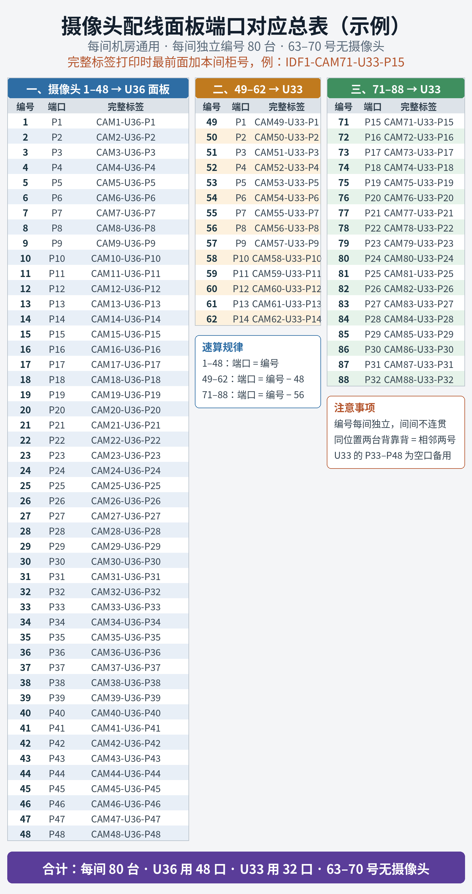

---

## 8. 母头在配线架上的排布（Keystone Jack Layout）

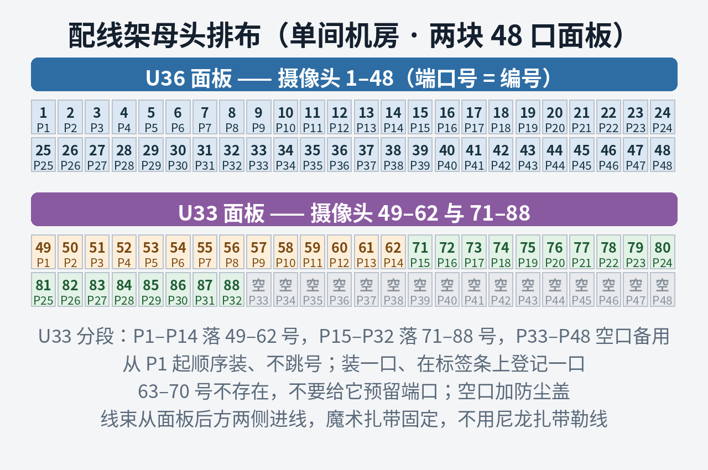

排布的原则就一条：**让"按表找口"永远不用动脑子。** 具体做法：

1. **按端口顺序装，不跳号**：从 P1 开始一块面板一块面板地装满，编号顺序 = 端口顺序（对照第 7 节的表）。跳着装、预留"好看的号"，是后期找线困难的头号来源。
2. **分段归属固定**：U36 整块只给 1–48；U33 的 P1–P14 给 49–62、P15–P32 给 71–88、P33–P48 空着作备用。任何人走到任何一间机房的柜子前，布局都一样——这就是间间同构的好处，排布也必须同构。
3. **装一口、登记一口**：每打好一个母头，立刻在配线架标签条上对应位置写下设备编号，并同步记台账。不要攒到一排打完再补登记，补登记必错位。
4. **后方理线跟端口分段对齐**：线束从配线架后方两侧进来，按端口段分束（一束 12 或 24 根，对应一段端口），在模块后方留够端接余量再打。扎带只用魔术扎带，松紧以线束能轻轻转动为准。
5. **空口管理**：没装母头的口加防尘盖/盲板；备用段（U33 P33–P48）在标签条上整段标注"备用"，不要把零星的线随手插进备用段——要用备用口，必须先改台账再动手。
6. **装完点数自检**：一块面板装完，从 P1 逐口点到 P48，边点边和台账对：有母头的口数、编号起止，必须和本段计划一致（U36 应为 48 个口全满；U33 应为 32 个口有头、16 个口空）。对不上当场查，不要留到测线阶段。

---

## 9. 线缆标签编号设计方法（Label Numbering Design）

标签是布线工程的"户口本"：线可以重拉，标签乱了，整个系统就没人敢动。设计方法如下。

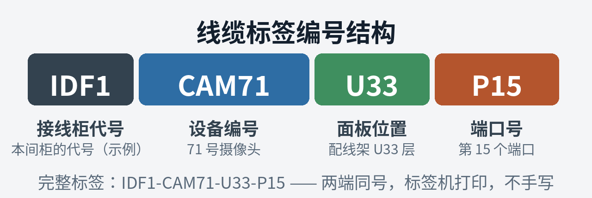

### 9.1 编号结构：四段式
**[接线柜号] - [设备编号] - [面板 U 位] - [端口号]**，例：`IDF1-CAM71-U33-P15`

- **柜号在最前**：因为编号每间机房重复（每间都有 71 号），不带柜号的标签出了本间机房就是废话。柜内贴的短标签可以省柜号，但凡是会拍照、会写进工单、会被带出机房的记录，一律用完整四段。
- **设备编号用图纸原号**：不要自己另编一套"好记的号"。图纸、标签、台账、控制器四处同名，是排障时唯一能对上的依据。
- **面板位置写 U 位**：U33/U36 直接对应机柜里的物理层数，拿着标签就能走到那一块面板前。

### 9.2 贴法规则
1. **两端同号**：同一根线的设备端和机柜端标签内容完全一致。贴之前先想清楚这根线落哪个口，不要"先贴个大概，回头再改"。
2. **位置固定**：两端各一枚，贴在离端接点 15–30 cm 处——太靠近端接点，返工剪头时标签会被剪掉；太远，找线时够不着看。
3. **只用打印标签**：正式标签一律标签机打印（绕线标签或旗形标签 flag label），耐擦、不褪色。手写只允许出现在两个地方：放线时写在线皮上的**临时编号**，和配线架标签条上的**当场登记**——两者事后都要被打印标签/台账取代或核对。
4. **临时编号不断档**：从拉线那一刻起，这根线在任何时刻都必须有一个能认出的身份：线皮手写号 → 临时旗签 → 正式打印标签，三级衔接，中间不许有"没名的线"。

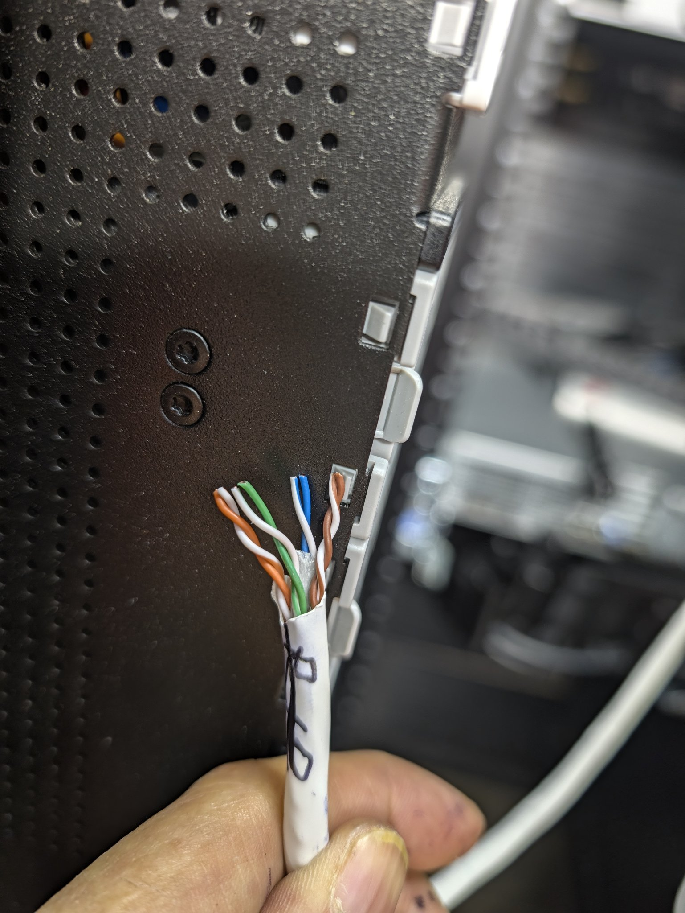

### 9.3 台账（对照表）维护
- 端口对应总表（第 7 节那张）就是台账母版：**打印一份贴机柜门内侧**，现场改动先用笔在纸上改、当天回填电子版。
- 改台账的规矩：谁改口、谁登记；旧编号划掉留痕，不涂抹——日后追溯靠这条痕。
- 交换机在 UniFi 控制器里的端口名与标签保持一致（如 CAM71），改一处、同步三处（标签、台账、控制器）。

---

## 10. 把线快速拉到定位的摄像头位置（Pulling to Camera Locations）

快的前提是**不返工**。返工最常见的原因是拉错位置、编号对不上、长度不够——下面这套流程就是冲着这三件事去的：

1. **按区分批，不要满场乱拉**：一次只拉一个系列/一个区（比如先把 71–88 这一圈拉完），本批根数 = 本区编号个数，先在图纸上逐个圈掉，圈一个拉一根。
2. **放线前先标两端**：线从线箱/线盘出来之前，先在预计的两个端头附近各写一次编号（线皮记号笔）+ 一枚临时旗签。**先标后拉**，拉到哪儿身份跟到哪儿；等拉完再回头认线，等于给自己出第 12 节的难题。
3. **估长留余量**：按图纸比例估算路径长度（桥架走向，不是直线距离），再留 2–3 m：机柜端要够走到配线架并留理线余量，设备端留一个 service loop（余量环）。宁可到位后剪掉一截，也不许差半米——接线是验收大忌。
4. **走主干、顺路下线**：先沿桥架主干把整束带到目标过道上方，再逐根下到点位；同过道的线成束同行，不要单根在桥架上反复穿梭。过弯处留人接应，禁止硬拽过死弯（伤线皮、压线对，认证时 NEXT/回损会报仇）。
5. **同位置两台一次拉两根**：背靠背的两台（相邻编号）一次把两根都拉到，分别标记、分别留环，下软管（flexible conduit）进各自的安装位。
6. **到位立即固定身份**：线一到点位，马上检查临时旗签还在、字迹清楚；拍一张"点位 + 编号"的照片存档（后期对图找线、对账都靠它）。机柜端汇集后，按第 8 节排布逐根上架，不要把一束线在柜顶堆过夜——堆一夜，顺序就乱了。
7. **当日闭环**：当天拉的线，当天端接、测通、换正式标签、回填台账。跨天的未端接线束是标签事故的高发区。

---

## 11. 端接验收四件套

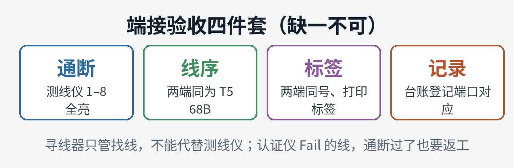

每根线端接完成，按这四样自检，全过才算交付：

| 检查项 | 标准 | 工具 |
|---|---|---|
| 通断 | 8 芯全通，1–8 灯序两端一致 | 测线仪 |
| 线序 | 两端同为 T568B，无 split pair 疑点（色标逐对核对过） | 目视 + 测线仪 |
| 标签 | 两端同号、四段式完整、打印标签 | 对照端口总表 |
| 记录 | 台账已登记，配线架标签条已写 | 台账母版 |

有认证要求（Fluke 报告）的项目，通断过不等于合格：长度、NEXT、回波损耗任一 Fail 都要返工重打，返工后重新出报告，不要拿"能通网"去说服验收方。

---

## 12. 标签杂乱错误时，快速定位一根线对应哪个摄像头

现场最常见的烂摊子：标签丢了、写错了、两端对不上。用下面这套打法，**一次只锁定一根、确认一根、标记一根**——批量"猜着贴"是标签全乱的根源，越救越乱。

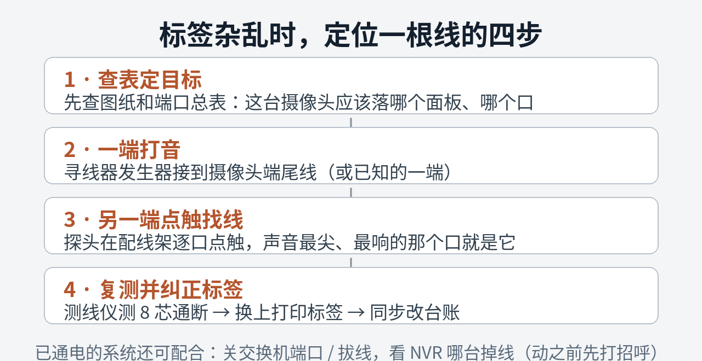

### 方法一：端口反查（线已规范上架时最快）
线在机柜端已经上了配线架的，先查总表：目标摄像头应该落哪个口；到那个口，用寻线器在配线架背面点触复核（发生器接在摄像头端），确认这根线的确从这个口出来，再沿桥架走向核对点位。适用于：只是标签掉了，落点本身没乱。

### 方法二：打音定位（标签全乱时的主力方法）
1. 发生器接**摄像头端**尾线（这是身份确定的一端：摄像头就在你眼前，它的编号看图纸点位就知道）。
2. 到机柜端，探头在配线架上**逐口点触**：先隔着线束粗扫分出大概区域，再逐口点触金属端子，声音最尖、最响的口，就是这台摄像头的线。
3. 锁定后立刻做三件事：测线仪测 8 芯通断 → 换上正确的打印标签 → 在总表上把这一行打勾销账。
4. 按这个流程一台一台过，一间机房的量，一个工作日可以全部理清——前提是理一台、销一台，不回头。

### 方法三：分束排除（线还没上架、一大堆混在柜顶时）
先别逐根打音。按桥架走向把线束**按区分束**（哪束从哪条过道来，大致对应哪个编号段），每束先抽 2–3 根打音定性，确认这束的编号范围，再在束内逐根找。范围从 80 根缩到十几根，速度差一个量级。

### 方法四：在线确认（系统已通电运行时）
在 UniFi 控制器里看交换机端口的 link 状态、PoE 功率和学到的 MAC，再配合 NVR：**关掉一个端口的 PoE（或拔掉一根跳线）→ 看哪台摄像头画面掉线** → 这根线就是它。注意：这招会真实断画面，只能在调试窗口期用，动之前跟工头/调试方打招呼；恢复后逐口核对端口名与实物标签是否一致，不一致当场改。

### 纠正纪律（比方法更重要）
- 找到一根、**当场**换打印标签、**当场**改台账；旧的错误标签当场撕掉——新旧两个标签并存，下一个人还会再乱一次。
- 拿不准的线宁可留空标签写"待查"，也不许猜一个号贴上：假标签比没标签危害大十倍。
- 全部理完后做一次收尾抽查：随机抽 5 个编号，用方法一反查复核，全对才算这批台账可信。

> **English — Correction discipline:** Label one cable at a time, on the spot. Remove the wrong label at once. A cable you are unsure about stays marked "to be checked" — a guessed label is worse than no label.

---

## 13. 本课英文术语速记

- **tone generator / amplifier probe (probe)** —— 信号发生器 / 感应探头；找线这个动作叫 **toning out a cable**
- **keystone jack** —— 母头（信息模块）；**patch panel** —— 配线架；**punch down** —— 打线（动词）
- **pass-through plug** —— 通孔式水晶头；**split pair** —— 分岔对（通断过、认证挂的隐形错误）
- **flag label** —— 旗形标签；**home run** —— 点位直拉机柜、中途不转接的线
- **service loop** —— 点位处预留的余量环；**fish tape** —— 穿线带/鱼线
- **PoE budget** —— 交换机 PoE 总功率预算；**uplink** —— 上行口
- **adopt** —— UniFi 设备"领养"（在控制器里纳管）
- **mag lock / electric strike** —— 磁力锁 / 电锁扣；**REX (request to exit)** —— 出门按钮；**door contact** —— 门磁

---

*本课为 AI-CABLE 实操系列，素材来自工地现场实拍与图纸；为保护项目信息，文中已隐去可识别具体项目的内容（柜号、平面图、日期）。编号口径：每间机房独立编号。*
